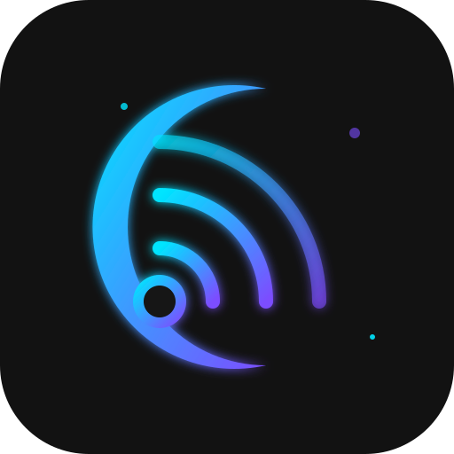

<div align="center">
  
  <h1>MoonTV-SUB</h1>
  <p>影视资源订阅 · 一键接入</p>
</div>


#### 上次更新时间：<sub></sub>


<mark>提示：</mark>您当前正在 Github.COM 查看源码。

为了获得最佳体验，请前往 <a href="https://moontvsub.120322.xyz/"><mark>文档站</mark>查看详情</a>

---

或者直接复制标准版订阅：
```
https://moontvsub.120322.xyz/sub/sub_best
```


---

订阅源支持EchoTV 、DecoTV 、 LunaTV 或衍生项目

LunaTV的订阅源，多版本随心选择，一键添加，持续更新中

---

免责声明：本项目仅供技术交流与学习使用，下载或保存后须在半小时内删除文件。所有资源均来源于互联网公开数据，一切数据与本项目无关。请勿用于商业用途。如因使用本订阅源产生的任何版权纠纷，本项目概不负责。
